# Un tell dalle foto del drone

Tell Sultan è una collina di insediamento in Siria, alta circa 25 m e larga 300. Il 25 settembre 2026 è stata fotografata con un piccolo drone DJI (fotocamera FC8482, 4032 × 2268
pixel, 24 mm equivalenti). Questo tutorial usa le 57 foto del suo ultimo volo, scattate a circa 110 m
dal suolo: 50 verticali e 7 oblique alla fine. In circa 7 minuti su un portatile ne ricavi:

* una nuvola densa di 3,3 milioni di punti e un modello con texture del tell;
* un DEM a 19 cm e un'ortofoto a 3,6 cm;
* curve di livello, una visualizzazione del rilievo che fa emergere gli elementi appena accennati,
  una sezione del tell disegnata in scala.

Non ci sono punti di controllo a terra: il rilievo è collocato dal GPS del drone, con pochi metri di
incertezza in posizione e quota. Forma, distanze, aree e volumi sono giusti; per portare il rilievo su
un sistema nazionale al centimetro si aggiungono target misurati con un ricevitore GNSS (vedi
l'[interfaccia](../gui.md#layout), pannello *Riferimenti*).

## I dati

Le foto di questo tutorial non sono pubbliche: seguilo con le tue foto da drone di un sito - qualche
decina di foto verticali che si sovrappongono, con le posizioni GPS che il drone vi scrive - raccolte in
una cartella. Passi, dialoghi e valori proposti sono gli stessi.

!!! note "Coordinate"
    Con le posizioni GPS il programma colloca il rilievo nel fuso UTM del sito. Nelle schermate il
    rilievo è stato spostato in un sistema locale (coordinate traslate, quote invariate), per non
    pubblicare la posizione del sito.

## 1. Un progetto nuovo con le foto

Avvia il programma e scegli *Nuovo progetto* nella pagina iniziale (oppure *File > Nuovo progetto*),
poi *File > Salva con nome...* per dargli un nome accanto alla cartella delle foto
(`tell_sultan.ppg`): da qui in poi ogni passo salva il progetto da solo.

*Flusso di lavoro > Aggiungi cartella...* e scegli la cartella `foto`. Le 57 foto compaiono nel
pannello *Foto* in basso, l'*Area di lavoro* a sinistra elenca il chunk con le sue camere.

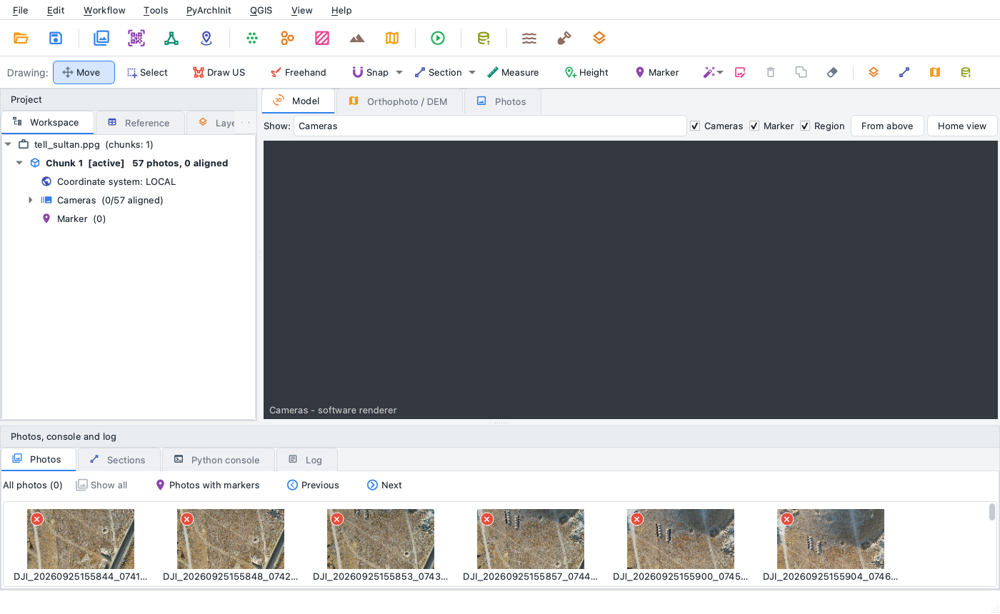

## 2. Allineare le foto

*Flusso di lavoro > Allinea foto...*

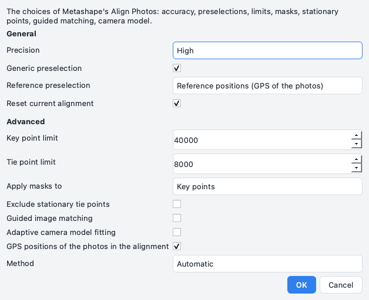

La finestra ha le scelte di *Allinea foto* di Metashape, e i valori proposti vanno bene per un rilievo
da drone: *Precisione Alta* (punti cercati sulle foto a metà dimensione), *Preselezione generica*
accesa - con più di 40 foto le coppie che si sovrappongono vengono trovate prima su foto
rimpicciolite e solo quelle vengono abbinate per intero - e *Preselezione di riferimento* sulle
posizioni di riferimento, il GPS delle foto. Sotto *Avanzate*: 40.000 punti chiave e 8.000 punti di
legame per foto, le maschere applicate ai punti chiave, i punti fermi di un turntable, l'abbinamento
guidato, l'adattamento adattivo del modello della camera, le posizioni GPS delle foto che tengono il
blocco quando le foto vengono collocate una dopo l'altra, e *Metodo Automatico*: da 40 foto in su
tutte le camere vengono collocate insieme (allineamento globale), molto più in fretta che una foto
dopo l'altra. *Azzera l'allineamento attuale* spento aggiunge le foto arrivate dopo a un allineamento
che c'è già. Il programma calcola da dove è stata scattata ogni foto e come l'obiettivo deforma
l'immagine e, poiché le foto hanno la posizione GPS, colloca il blocco nel fuso UTM del sito.

Qui: 57 foto su 57 allineate in circa tre minuti, 316.000 punti di legame. La vista
*Modello* mostra i punti di legame e le posizioni delle camere sopra la collina: le lunghe strisciate
del volo e le foto oblique intorno.

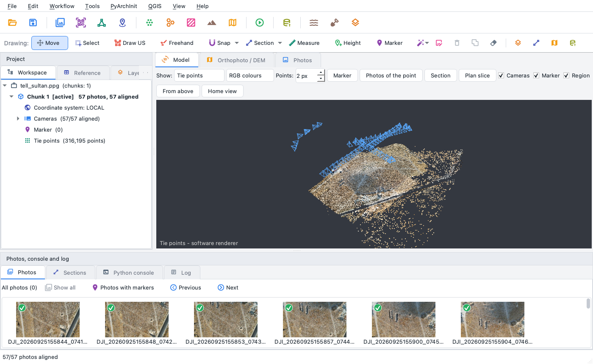

Il pannello *Riferimenti* elenca, per ogni camera, la posizione GPS e quella data
dall'allineamento, con la differenza: qualche metro è la precisione del GPS del drone, non un errore
del rilievo.

## 3. Nuvola densa

*Flusso di lavoro > Costruisci nuvola densa...*

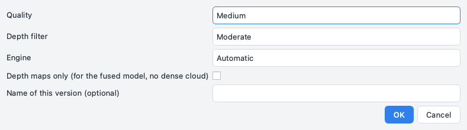

*Qualità Media* calcola una mappa di profondità per ogni foto a un quarto della dimensione, il
*Filtro profondità Moderato* toglie i punti isolati. Con il motore *Automatico* un rilievo aereo - foto
con posizioni GPS sparse sul sito - viene elaborato con il PatchMatch multi-vista (un piano per pixel
confrontato con più foto insieme, nel nucleo nativo su tutti i core della CPU): pendii lisci, senza i
gradini dello stereo a coppie. In meno di due minuti, 3,3 milioni di punti, colorati dalle foto; ogni punto
conserva quante mappe di profondità lo confermano (*confidenza*).

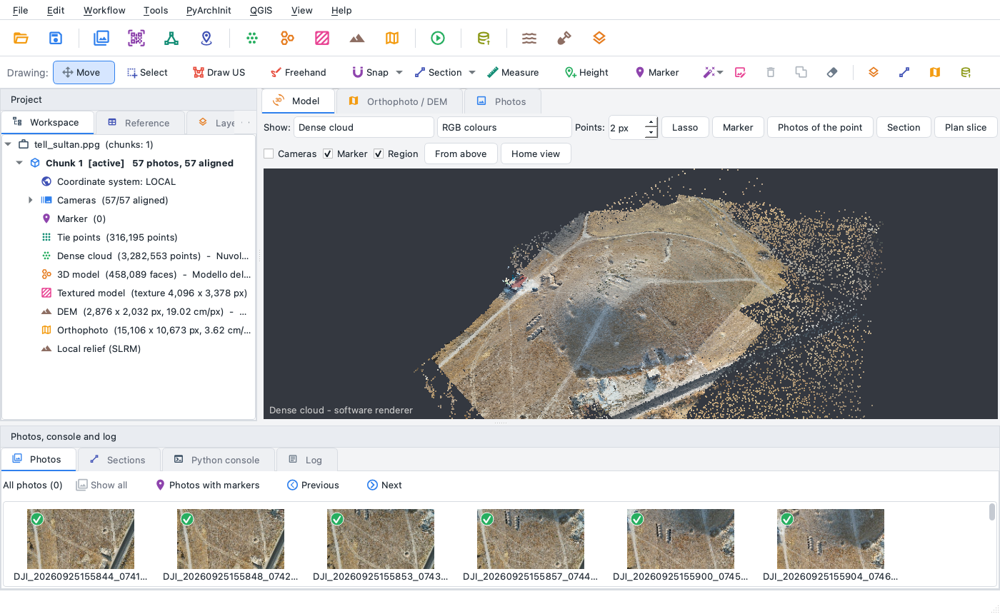

## 4. Modello e texture

*Flusso di lavoro > Costruisci modello...* (sorgente *Nuvola densa*, superficie *Arbitraria*, facce
*Medio*) crea una mesh di 448.000 facce in 24 s; *Flusso di lavoro > Costruisci
texture...* la colora dalle foto in 27 s.

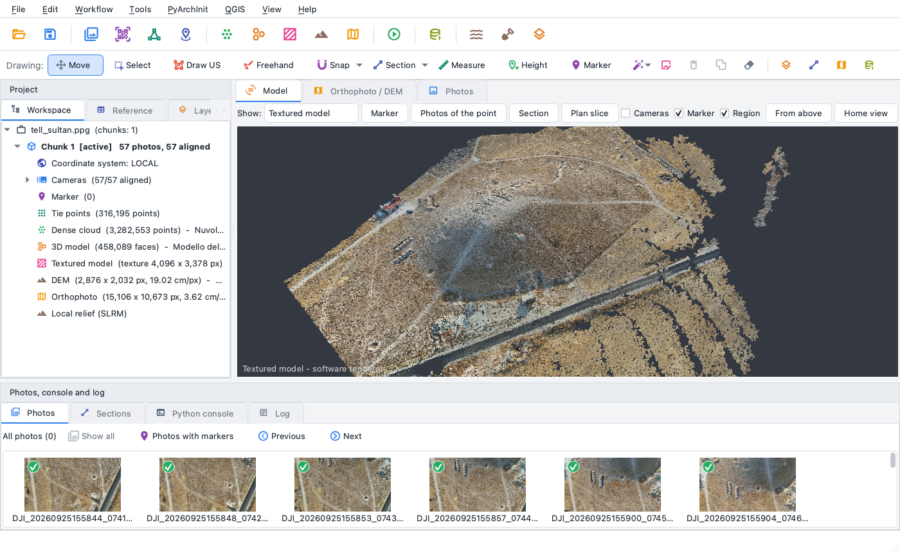

## 5. DEM e ortofoto

*Flusso di lavoro > Costruisci DEM...* con i valori proposti: dalla nuvola densa, risoluzione scelta
dalla densità dei punti (19 cm qui), tolti i picchi di una cella lasciati dai punti spuri,
vuoti interpolati: pochi secondi.

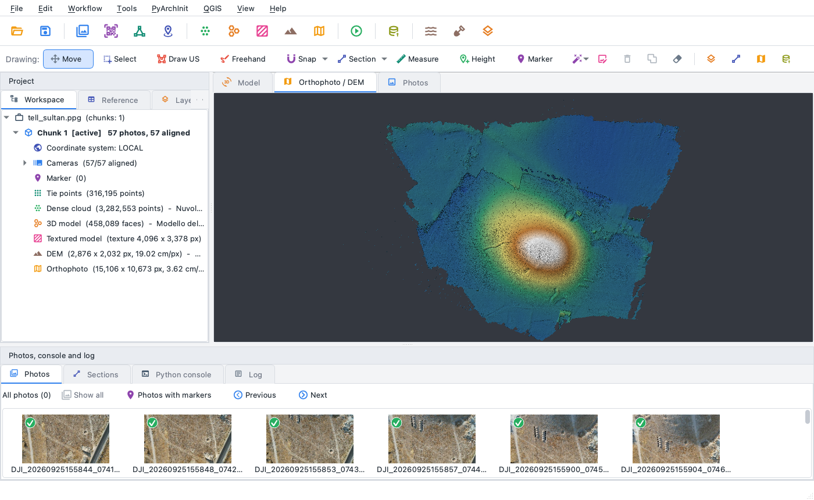

*Flusso di lavoro > Costruisci ortofoto...*: le foto proiettate sul DEM, ogni cella presa dalla foto
che la vede più dall'alto, fusione senza cuciture, correzione del colore delle foto, piccoli buchi
riempiti. Mezzo minuto per un'ortofoto di 15.196 × 10.753 pixel a 3,6 cm.

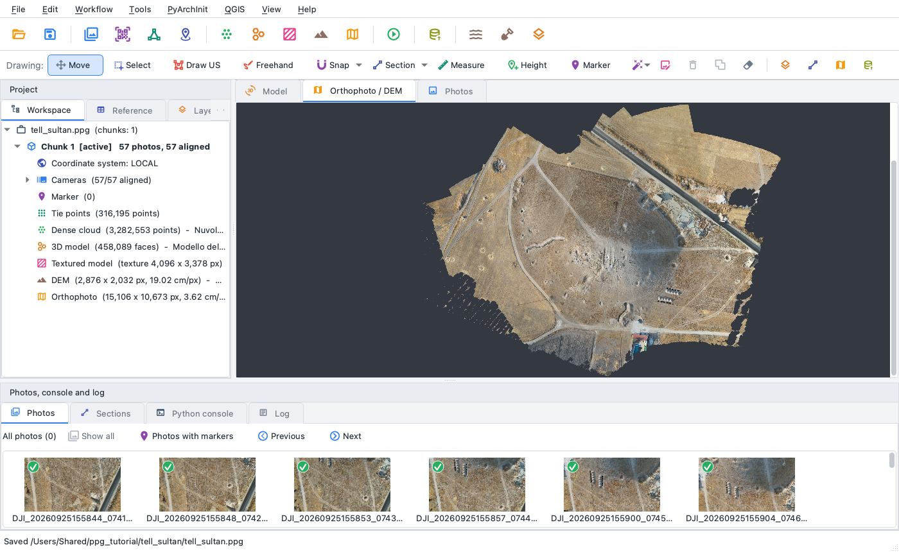

Quando ingrandisci, la vista *Ortofoto / DEM* rilegge il file a piena risoluzione: il dettaglio
delle foto resta visibile.

## 6. Curve di livello

*Strumenti > Curve di livello...* propone un'equidistanza dal dislivello del DEM (2 m
qui), una curva direttrice ogni 5, e le salva in DXF, GeoPackage o GeoJSON. Le curve sono disegnate
anche come layer sul DEM.

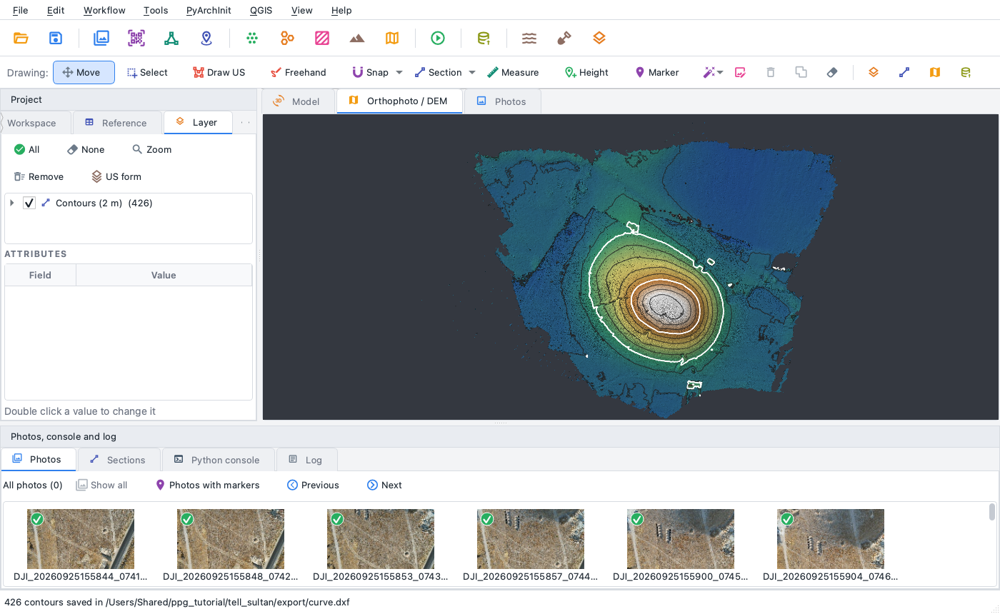

## 7. Visualizzazione del rilievo

Le quote a colori e un'ombreggiatura sola nascondono quello che sporge o si abbassa di pochi
centimetri: muri sotto la superficie, terrazzamenti, buche, tracciati. *Strumenti > Visualizzazioni
del rilievo...* offre lo sky-view factor, l'openness positiva e negativa, il rilievo locale e
multiscala e un'ombreggiatura illuminata da 16 direzioni. Qui il rilievo locale (SLRM): il DEM meno
la sua media nel raggio di ricerca, rosso dove il terreno sta sopra i dintorni, blu dove sta sotto.

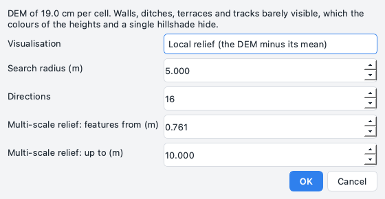

Sulla collina: il fossato curvo sul pendio occidentale, buche, le strutture rettangolari e i limiti
dei campi intorno; il cursore dà l'altezza sui dintorni in centimetri.

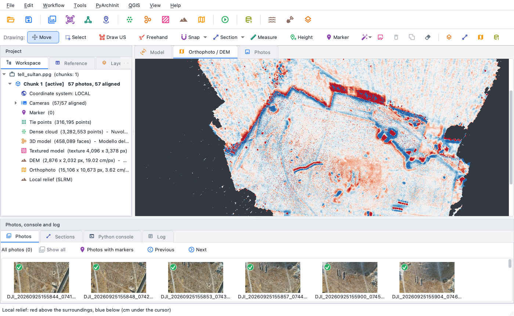

## 8. Una sezione del tell

Lo strumento *Sezione* della barra di disegno: due clic sul DEM, da ovest a est attraverso la cima
della collina. Il programma taglia il modello lungo la linea e scrive il disegno in scala (SVG), il
profilo (DXF) e la linea 3D (DXF) nella cartella `sezioni` accanto al progetto; il pannello *Sezioni*
in basso lo mostra.

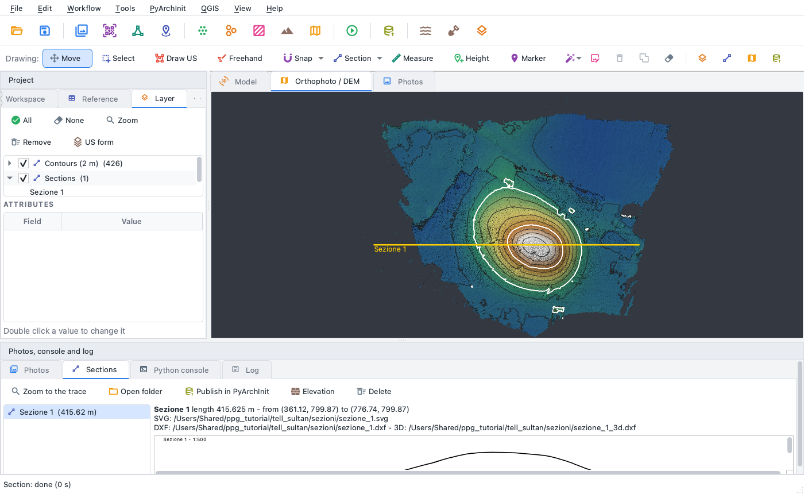

## 9. Portare via i risultati

* *File > Esporta*: ortofoto e DEM in GeoTIFF (anche Cloud Optimized), nuvola densa in LAS, LAZ o PLY,
  modello in OBJ, PLY o GLB, le camere, e tutto ritagliato con un riquadro o un poligono.
* *QGIS > Apri in QGIS (collegamento dal vivo)*: ortofoto, DEM e layer disegnati in un progetto QGIS
  sempre aggiornato.
* *File > Genera report HTML...*: foto, allineamento, errori e prodotti in una pagina.
* *PyArchInit > Pubblica ortofoto / DEM / modello...*: i prodotti come documentazione di un sito
  ([PyArchInit](../pyarchinit.md)).

## Gli stessi passi da riga di comando

```bash
ppg new tell_sultan.ppg
ppg add-photos tell_sultan.ppg foto
ppg align tell_sultan.ppg                    # --quality high
ppg dense tell_sultan.ppg                    # --quality medium --filter-mode moderate
ppg mesh tell_sultan.ppg                     # modello e texture
ppg dem tell_sultan.ppg
ppg ortho tell_sultan.ppg
ppg export tell_sultan.ppg --dem dem.tif --ortho ortofoto.tif --cloud nuvola.laz --report report.html
```

## Gli stessi passi in Python

```python
import pyarchinit_photogrammetry as ppg

doc = ppg.Document()
chunk = doc.add_chunk()
doc.chunk = chunk
doc.save("tell_sultan.ppg")
chunk.add_photos(["foto"], recursive=True)
chunk.match_photos("high")
chunk.align_cameras()
chunk.build_depth_maps("medium", "moderate")
chunk.build_point_cloud()
chunk.build_model(source="point_cloud", face_count="medium")
chunk.build_texture(4096)
chunk.build_dem()
chunk.build_orthomosaic()
doc.save()
chunk.export_dem("dem.tif")
chunk.export_orthomosaic("ortofoto.tif")
```

## Tempi

Su un Apple M4 Pro (8 core ad alte prestazioni e 4 ad alta efficienza, 24 GB), con l'applicazione
desktop:

| Passo | Tempo |
|---|---:|
| Allineamento (57 foto) | 3 min 6 s |
| Nuvola densa (PatchMatch) | 1 min 51 s |
| Modello | 24 s |
| Texture | 27 s |
| DEM | 6 s |
| Ortofoto | 28 s |
| Curve di livello, rilievo, sezione | 8 s |

Le stesse foto con Metashape Pro e ODM: vedi il [benchmark](../benchmark.md).
